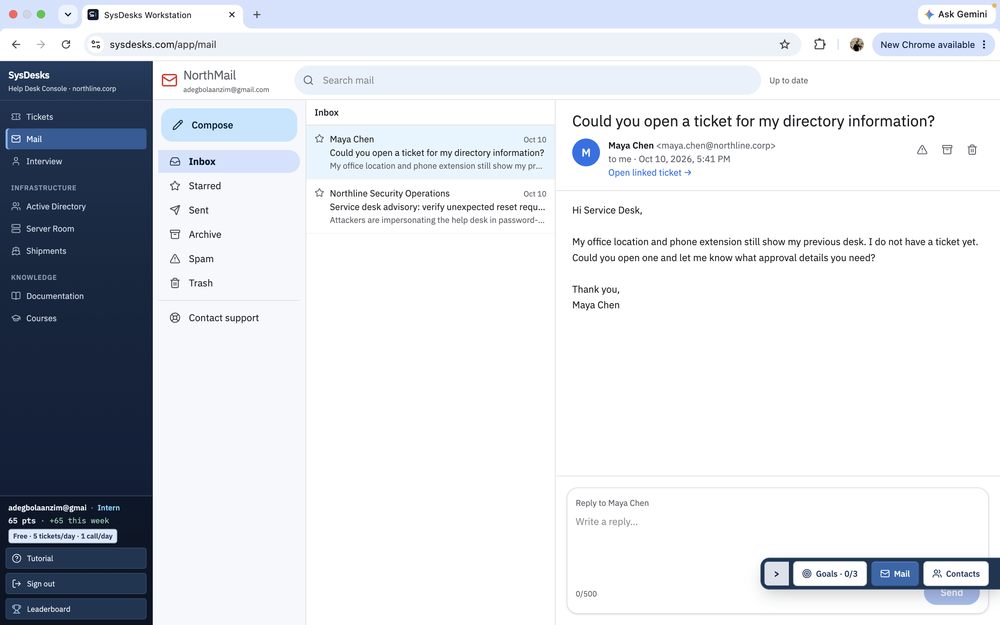
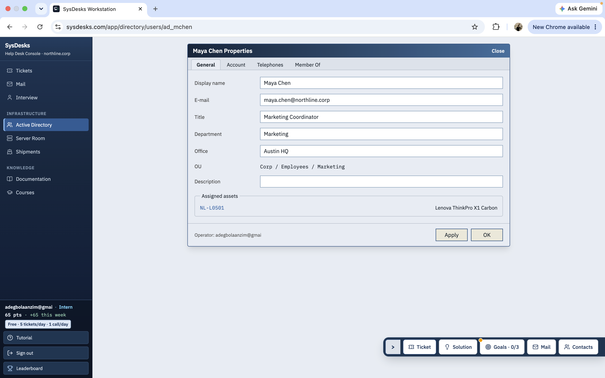
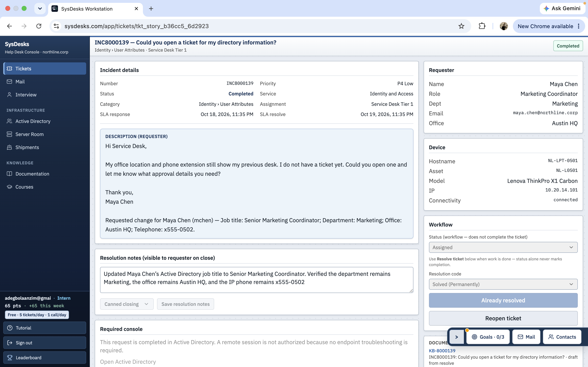

# Active Directory User Attribute Management

## Project Overview
in this project i demonstrates how to investigate and update user attributes
in a simulated Active Directory environment while documenting a help desk
incident from start to finish.

**Incident ID:** INC8000139  
**User:** Maya Chen  
**Environment:** Simulated SysDesks Help Desk and Active Directory Lab

## Problem Description
Maya Chen reported that her directory information was outdated.
Her job title and telephone extension needed to be corrected.

The objective was to locate the correct Active Directory account,
verify the existing attributes, make the requested changes.

## Investigation
1. Reviewed incident INC8000139 and the user's request.
2. Searched Active Directory for Maya Chen's account.
3. Encountered a read only properties view when opening an incorrect
   or duplicate account entry.
4. Searched using the user's `sAMAccountName` to locate the correct account.
5. Opened the correct account and reviewed its properties.

## Changes Made

 - Attribute Before: Job Title(Marketing Coordinator);Telephone(x555-0501);Department(Marketing);Office(Austin HQ)
  
 - Attribute After: Job Title(Senior Marketing Coordinator);Telephone(x555-0502);Department(Marketing);Office(Austin HQ)
 
## Results
Updated the requested job title and telephone information in the
simulated Active Directory environment. Verified the updated attributes
in the account properties.

The department and office location remained unchanged.

## Skills Demonstrated
- Active Directory user account management
- User attribute modification and verification
- Account investigation using `sAMAccountName`
- Help desk incident documentation
- Troubleshooting read only account properties
- Technical documentation

## Screenshots

### 1. Initial Ticket

### 2. Directory Information Before Changes

### 3. Directory Information After Changes

### 4. Ticket Resolution

