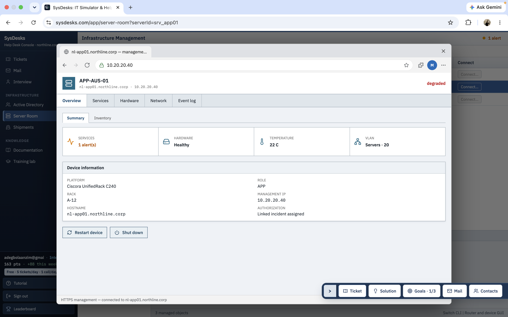
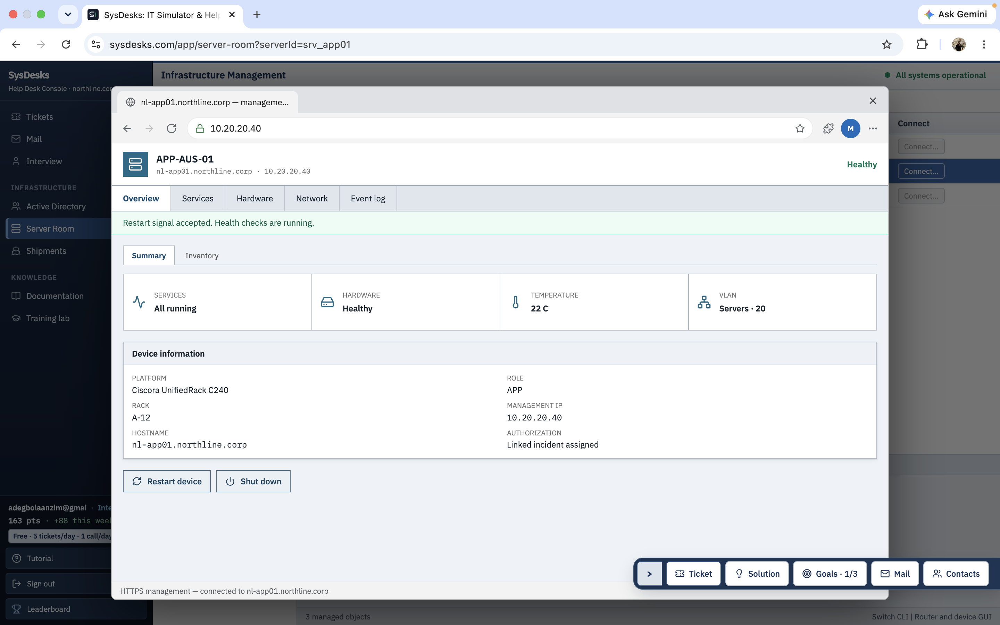
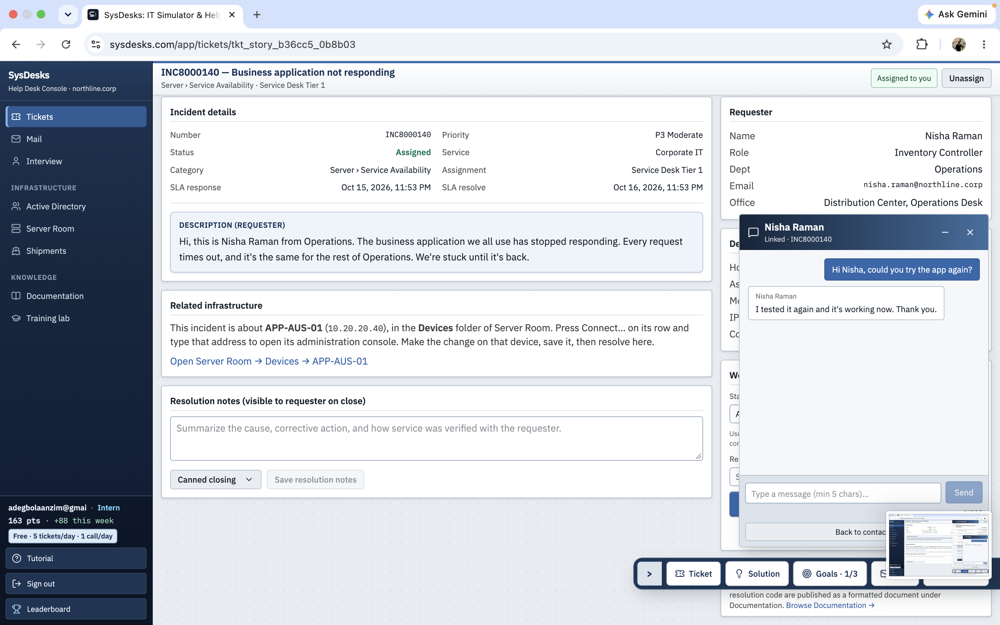

# Business Application Service Recovery

## Project Overview

This project documents my troubleshooting of a business application
outage using the SysDesks IT Simulator.

## Incident Details

- **Incident ID:** INC8000140
- **Incident Title:** Business Application Not Responding
- **Priority:** P3 Moderate
- **Category:** Server / Service Availability
- **Affected Server:** APP-AUS-01
- **Server IP:** 10.20.20.40
- **Requester:** Nisha Raman
- **Department:** Operations
- **Final Status:** Resolved

## Problem

The requester reported that the business application repeatedly
timed out. Other employees in the Operations department experienced
the same issue, preventing them from completing their work.

## Troubleshooting Process

### 1. Investigated Server Health

Opened Server Room in the SysDesks simulator and selected
APP-AUS-01.

The initial health check showed that the server was degraded,
with only one of its two services running.

### 2. Accessed the Management Console

Opened the server management interface and entered the server's
management IP address:

`10.20.20.40`

Navigated to the Services tab to inspect the service status.

### 3. Restored Service Availability

Performed the service recovery action through the management
interface.

The simulator accepted the restart signal and initiated health
checks.

The server subsequently reported:
- All services running
- Hardware healthy
- Server status healthy

### 4. Verified the Resolution

Contacted Nisha Raman and asked her to test the application again.

The requester confirmed that the application was working correctly.

## Root Cause

The incident was associated with a stopped service on the
application server.

## Resolution

Restored service availability on APP-AUS-01 and verified that all
services were running and the server was healthy.
Confirmed successful application access with the requester.

## Skills Demonstrated

- IT incident management
- Server health monitoring
- Service availability troubleshooting
- Server management console navigation
- Application recovery verification
- End user communication

## Tools Used

- SysDesks IT Simulator
- Server Room management interface
- Application server diagnostics

## Key Takeaway

A server can remain reachable while a hosted application is
unavailable. Checking service health, restoring service availability,
and validating the fix with the end user are important steps in
resolving application incidents.
