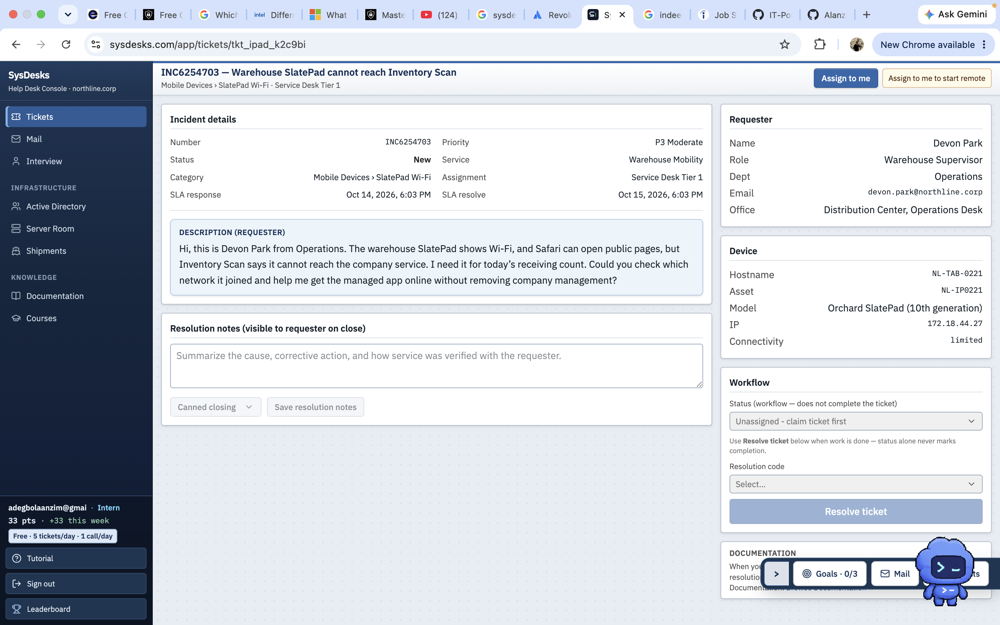
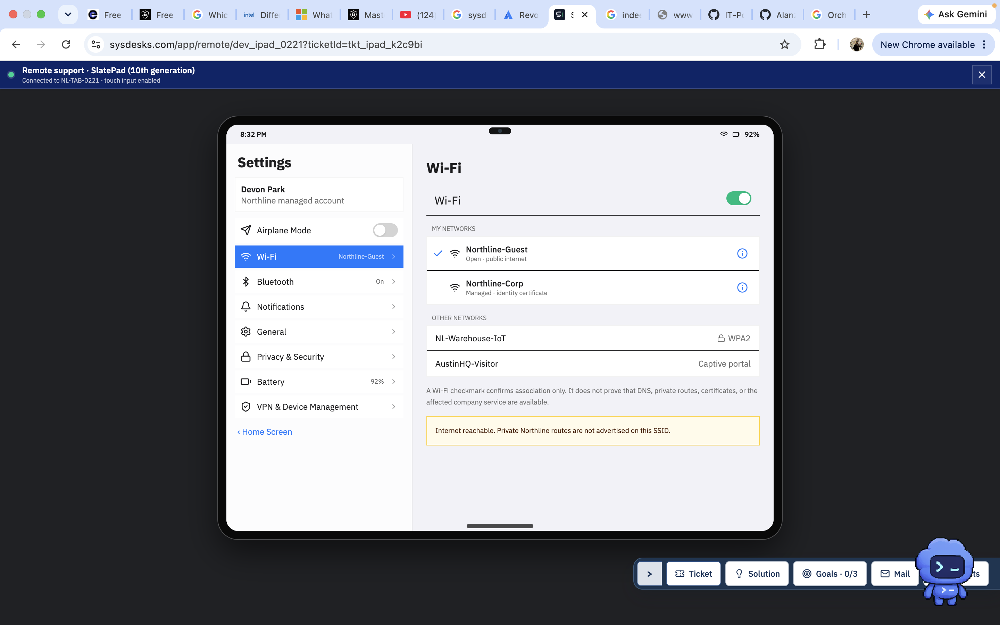
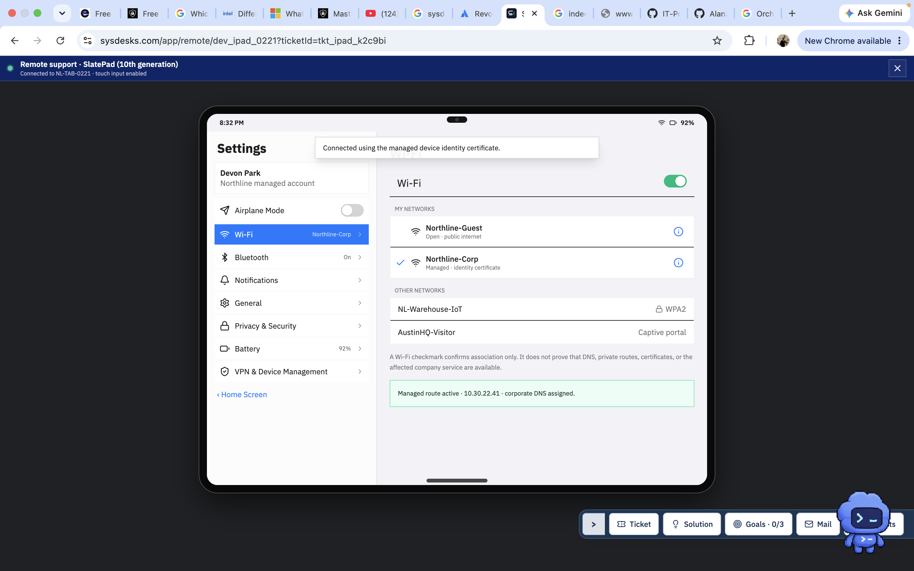
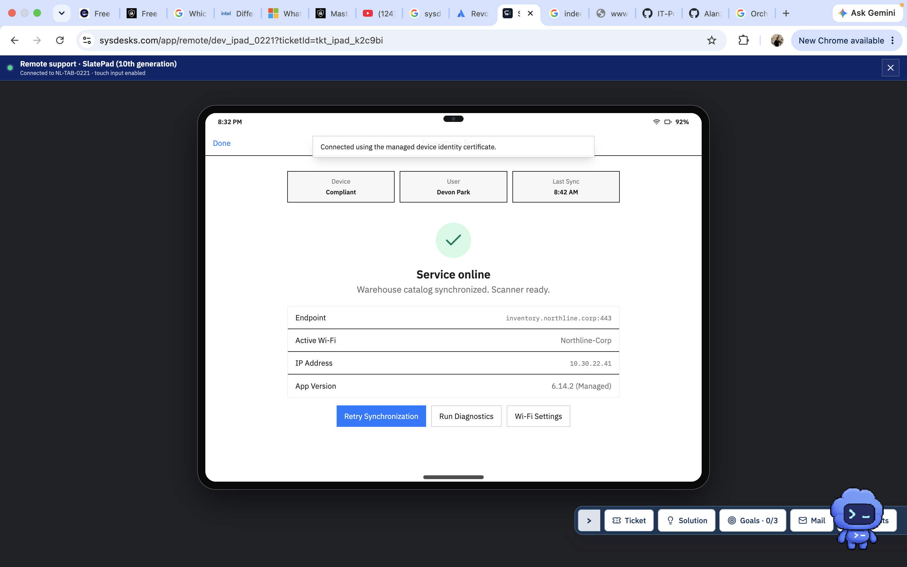

# Mobile Device Network Troubleshooting

## Project Overview

This project documents a simulated Tier 1 IT support incident involving a managed warehouse tablet that could not access the Inventory Scan application.

## Problem Description

The warehouse supervisor reported that the tablet could access public websites but could not connect to the company's Inventory Scan service.

## Environment

- Device: Orchard SlatePad (10th generation)
- Operating System: Simulated managed tablet
- Platform: SysDesks
- Network: Wi-Fi

## Troubleshooting

The tablet was connected to Northline-Guest. Although public internet access was available, the corporate network routes required by Inventory Scan were unavailable.

The tablet was connected to Northline-Corp using its managed device identity certificate.

## Results

- Corporate network connectivity restored.
- Managed corporate route and DNS configuration activated.
- Inventory Scan service came online.
- Warehouse catalog synchronized successfully.
- Scanner confirmed ready.

## Skills Demonstrated

- Wi-Fi troubleshooting
- Network connectivity diagnosis
- Enterprise network authentication
- Mobile device management
- Application troubleshooting
- Technical documentation

  ## Screenshots

### 1. Initial Support Ticket
The warehouse supervisor reported that the Inventory Scan application could not connect to the company service.

### 2. Network Diagnosis
The tablet was connected to Northline-Guest, which provided public internet access but not the required corporate network routes.

### 3. Corporate Wi-Fi Connected
Connected the managed tablet to Northline-Corp using its device identity certificate.

### 4. Inventory Scan Restored
Verified that Inventory Scan was online, the warehouse catalog was synchronized, and the scanner was ready.

