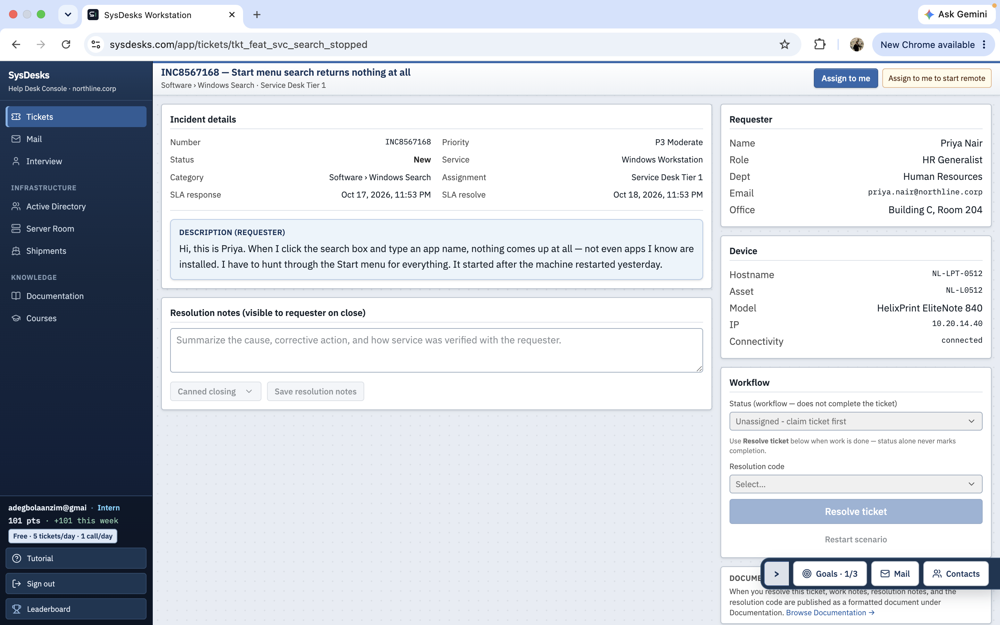
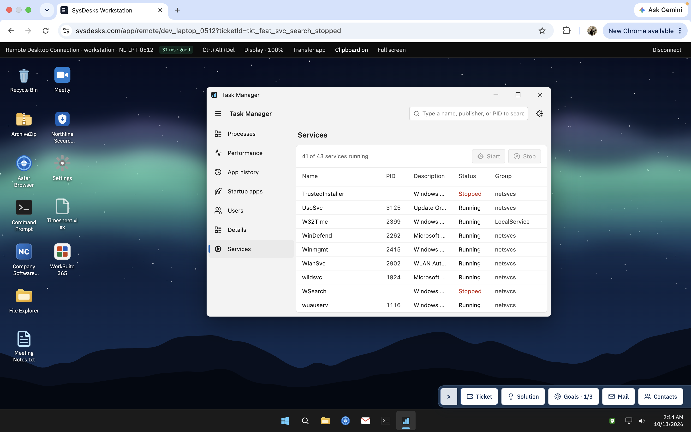
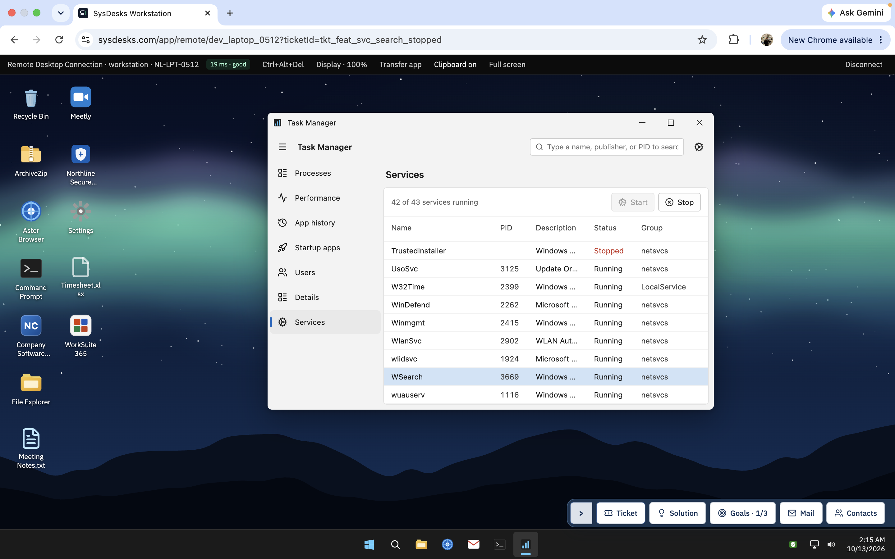
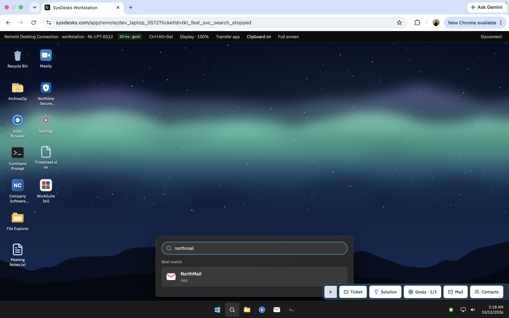
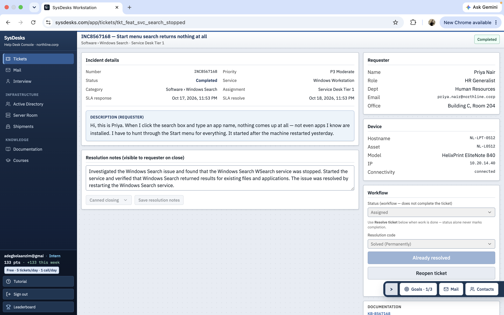

# Windows Search Troubleshooting

## Project Overview

Troubleshot a simulated Windows 11 help desk incident involving a Start menu search that returned no results.

**Ticket:** INC8567168  
**Category:** Software>Windows Search  
**Device:** NL-LPT-0512  
**Environment:** SysDesks simulated help desk lab

## Problem Description

The user reported that Windows Start menu search returned no results when searching for applications. The issue began after the computer restarted.

## Investigation

1. Opened Task Manager.
2. Navigated to the Services section.
3. Located the Windows Search service (`WSearch`).
4. Found that the service was stopped.

## Troubleshooting Steps

1. Selected the stopped Windows Search service.
2. Started the service.
3. Verified that the service status changed to Running.
4. Tested Windows Search and confirmed that results appeared for existing files and the NorthMail application.

## Results

The Windows Search service was restarted successfully, and search results began appearing again.

## Skills Demonstrated

- Windows 11 troubleshooting
- Task Manager
- Windows services
- Windows Search diagnostics

## Screenshots

### 1. Initial Ticket

### 2. Windows Search Service Stopped

### 3. Windows Search Service Running

### 4. Search Results

### 5. Solution Walkthrough Completed

